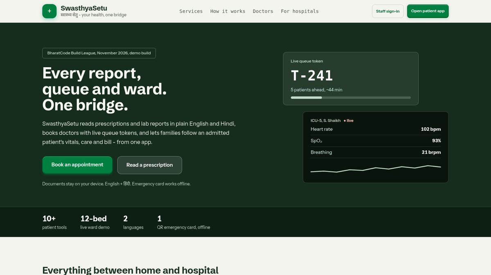
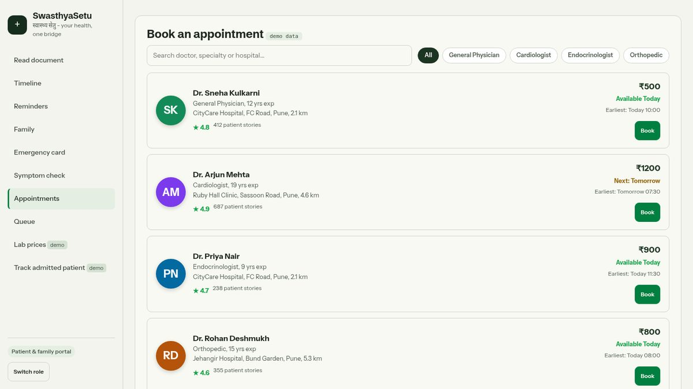
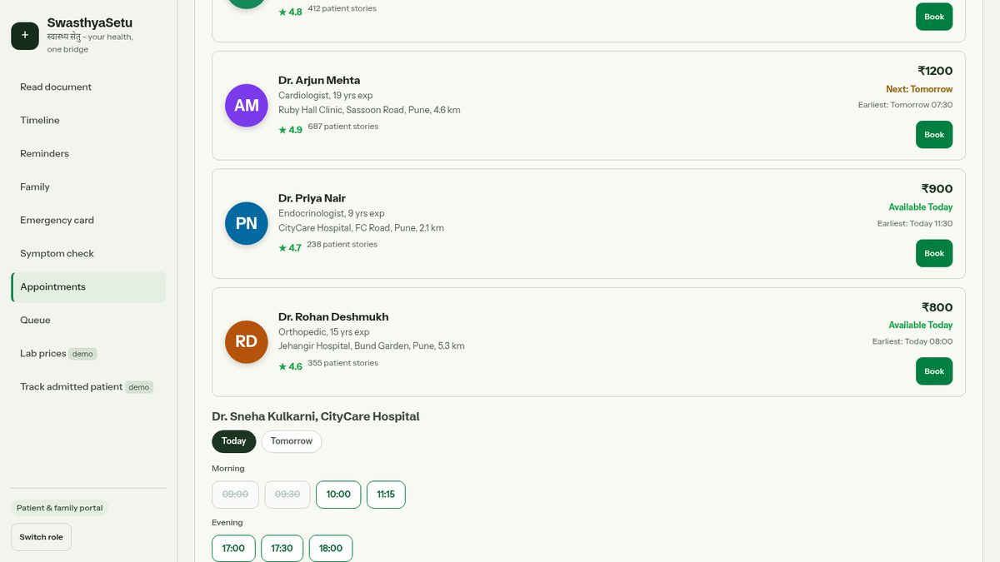
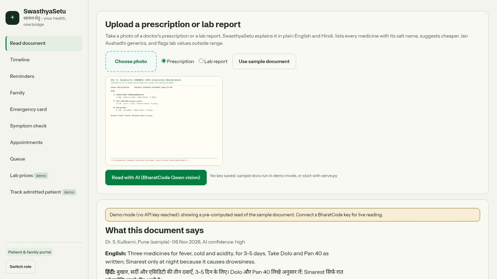
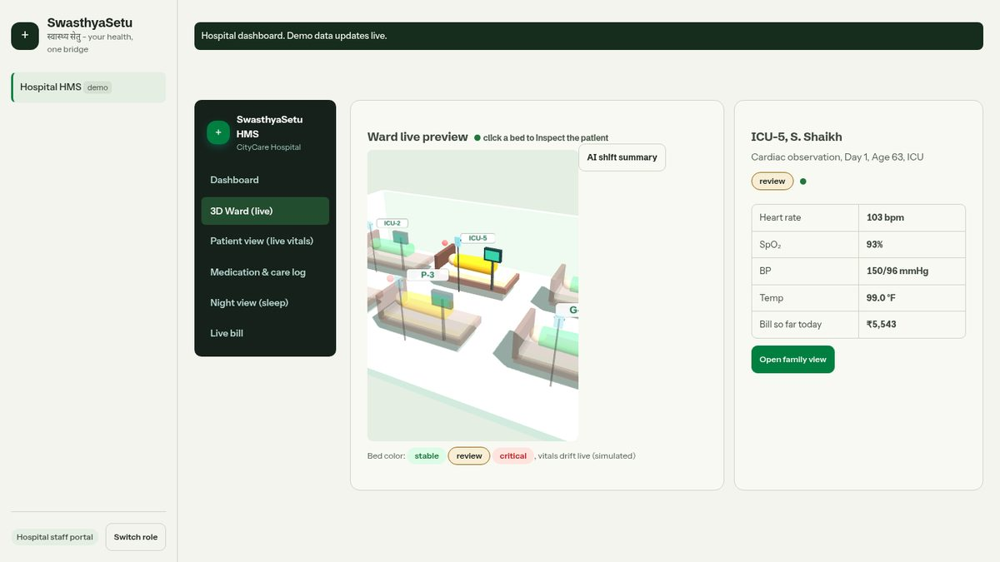
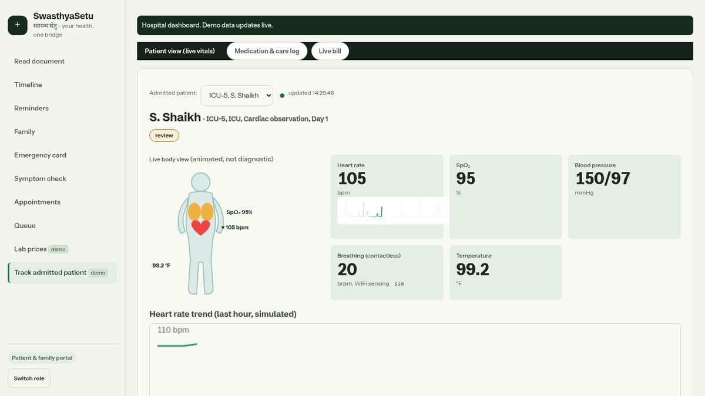

# SwasthyaSetu (स्वास्थ्यसेतु) - one-stop health bridge for Indian families

Built for the BharatCode Build League hackathon by Vaibhav Jain.

SwasthyaSetu helps an Indian family keep all its health work in one place: read a
doctor's prescription or lab report with AI (in English + Hindi), track medicines and
lab values over time, get medicine reminders, keep an emergency card with QR, and
book/track appointments - including a peek at how a hospital dashboard could plug in.

## Run it (pick one)

```bash
python3 serve.py        # then open http://localhost:8000
```

That is the whole setup - Python 3 only, nothing to install. Everything works:
both portals, the 3D anatomy model, and (with a key) live AI reading.

**Or just double-click `index.html`.** The app works offline straight from the
file system - sample documents, booking, queue, ward, all of it. The only things
that need the little server are the 3D anatomy model (browsers block local 3D
files) and the live AI proxy; a note at the bottom of the page reminds you.

Any other static server (`npx serve`, `python3 -m http.server`, VS Code Live
Server) also works - only the AI key proxy is specific to serve.py.

**Live AI reading (optional):**
```bash
export BHARATCODE_API_KEY=sk-your-key   # BharatCode student key
python3 serve.py
```
Or paste the key into the key box on the Scan tab (stored only in your
browser's localStorage). With no key, sample documents show a pre-computed
demo read so the flow is always demonstrable.

## Live demo

**https://a2wkiller.github.io/swasthyasetu/** - hosted on GitHub Pages. Everything
works there except live AI reading (Pages is static, so the server-side key proxy
is not available); paste a BharatCode key into the Scan tab's key box for live reads,
or use the built-in demo reads.

## Demo video (50 s, with voiceover)

Watch **[docs/demo.mp4](docs/demo.mp4)** (or [download the raw file](https://raw.githubusercontent.com/A2wkiller/swasthyasetu/main/docs/demo.mp4)):
a guided tour of the whole app - landing, booking a real appointment with a live
queue token, the AI document reader (English + Hindi), the staff dashboard, the 3D
ward by day and night, and the family view of an admitted patient. Voiceover explains
why we built it and what is real vs simulated.

## Screenshots

| | |
| --- | --- |
|  |  |
|  |  |
|  |  |
|  | |

## Two portals, one app

- **Patient & family portal** (no sign-in): AI document reader, timeline, reminders,
  family profiles, emergency card, symptom triage, Practo-style appointment booking,
  live queue tracking, lab prices, and **Track admitted patient** - live vitals, 3D
  anatomy view, nurse care log and the growing bill of an admitted family member.
- **Hospital staff portal (HMS)** (demo staff sign-in, role-labeled): live 3D ward
  (three.js, orbit, click-to-inspect), patient vitals, medication & care log with a
  staff entry form (families see entries instantly), and live billing.
Both portals run on the same shared simulated ward state, so a nurse entry or a new
charge shows up on the family side within seconds.

## What is REAL vs DEMO in this build

| Feature | Status |
| --- | --- |
| Prescription / lab-report reader (vision) | **Real** - BharatCode Qwen vision model reads the uploaded image, returns structured JSON with medicines, generic (Jan Aushadhi) alternatives, lab flags, EN+HI summaries. Demo-mode fallback only when no API key is reachable. |
| Timeline + lab-value trend chart | **Real** - built from your own scanned documents, stored on-device (localStorage). |
| Medicine reminders | **Real** - on-device, in-browser while the app is open. |
| Family profiles | **Real** - on-device. |
| Emergency card + QR | **Real** - QR encodes the card text offline (qrcode.js, vendored). |
| Symptom pre-check | **Real, rule-based** - red-flag escalation + specialty suggestion. Triage only, never a diagnosis. |
| Appointment booking + queue tracker | **Demo** - Practo/BookMyShow-style doctor discovery (ratings, fees, availability), day/slot picker, ticket with QR token, live queue. Simulated data. |
| Lab price compare + home sample | **Demo** - illustrative prices, not live lab rates. |
| Hospital dashboard | **Demo, live-simulated** - isometric 3D ward with status-colored beds that update every 2 s; family view with live vitals, ECG sweep, HR trend, animated body view (original SVG; heart pulses at the patient's live HR); nurse medication/care log posted live; itemized bill that grows as charges post. The AI shift-note button uses the real model when a key is available. |

## Privacy and safety

- Everything except the AI reading runs on-device; nothing is uploaded anywhere else.
- Scanned document images go only to the BharatCode API (hackathon judge model) for reading.
- The app is an understanding aid, **not medical advice**. Always confirm with a doctor or pharmacist.

## Tech

Vanilla HTML/CSS/JS single-page app (no build step), `serve.py` (Python stdlib) as a
static server + `/api/responses` proxy so the API key never ships in the browser.
QR: vendored qrcodejs (MIT). 3D: three.js (MIT) with a real anatomy model
(vendor/body.glb, CC BY-SA 4.0 - Z-Anatomy, simplified by hpfrei; see NOTICE).
The animated body view falls back to an original SVG if WebGL is unavailable. AI: BharatCode `qwen-3.8-27b` vision model via the
OpenAI-compatible Responses API.

## Files

- `index.html`, `styles.css`, `app.js` - the app
- `serve.py` - local server + API proxy
- `samples/` - synthetic sample prescription & lab report (clearly marked SAMPLE; not real patients)
- `vendor/qrcode.min.js` - qrcodejs (MIT license)

Made with BharatCode AI credits.
